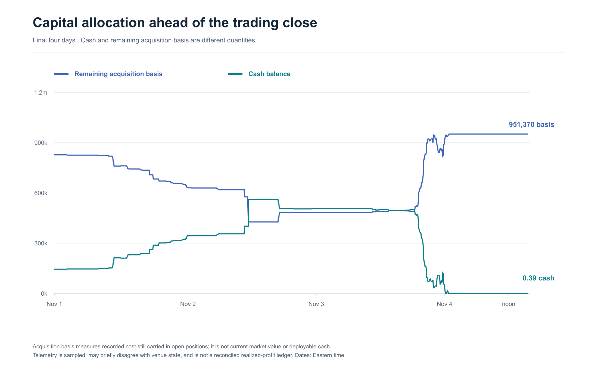
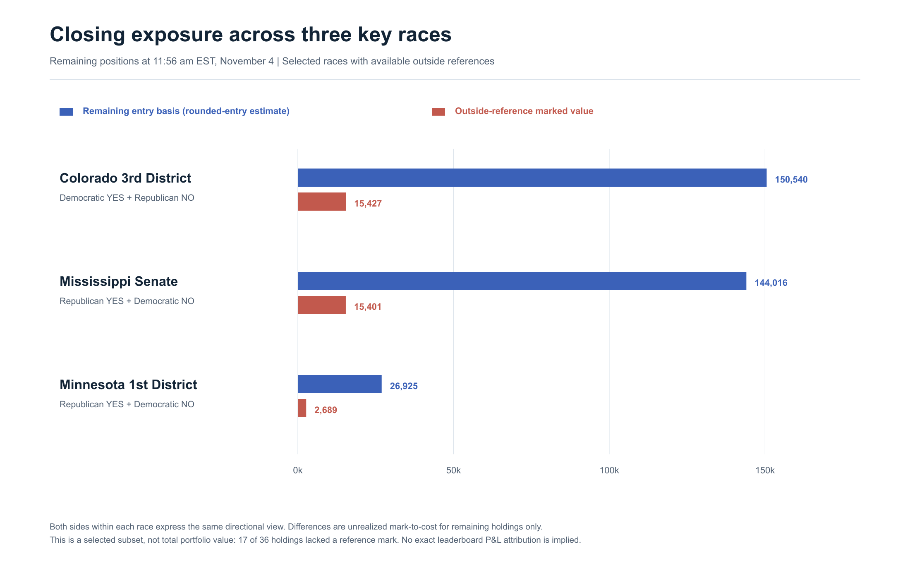

# Engineering a Rust trading system for the SIG Predictions Cup

*From 100,000 to 762,110 in marked account value. A study in quantitative research, real-time systems, and trading operations.*

**[Explore the visual case study](https://tristandarnell.github.io/SIG-Predictions-Cup-Writeup/)** · [Methods and evidence](docs/methods.md) · [Project summary](docs/project-summary.md)

We built and operated a trading system that grew a 100,000-SUSQie starting account to **762,109.67 in marked value**, a **+662.11% marked return**. The first post-close leaderboard showed our account, **bright-finch-0400**, in **sixth place**. Our highest recorded value was 1,054,548.74, and our best observed rank was second. These are pre-settlement results as of November 4, 2026.

The project connected quantitative ideas to an operating system: a Rust trading engine, outside-market reference prices, passive orders designed to catch large flows, inventory management, and Python research and operator tools. Over the competition, the venue recorded **27.04 million in volume across 18,027 orders with fills**. The work spanned strategy design, market-data integration, execution, testing, monitoring, and incident analysis.

The strongest technical lesson was that finding an apparent price discrepancy was only the beginning. Order ownership, available cash, position accounting, and the risk of carrying a position into new information determined what happened next. The account made substantial early progress, and election night exposed limitations that are just as useful to understand as the gains.

## Project at a glance

| Area | Work demonstrated |
|---|---|
| Trading infrastructure | Rust/Tokio engine integrating streaming updates, REST recovery, order submission, and account reconciliation |
| Market-data engineering | Contract mapping, outcome inversion, source freshness, spread and disagreement checks across Kalshi and Polymarket US |
| Quantitative research | Queue-sensitive replay, forward shadow testing, inventory and capital-allocation experiments |
| Operational discipline | Pending-order reservations, idempotency, cancellation handling, monitoring, and investigation of concrete failures |
| Performance analysis | Reconstruction from 24,064 leaderboard snapshots and a 10.9-million-row journal, with explicit accounting and coverage limits |

The operation combined automation with human supervision and AI-assisted development. It was not a fully autonomous forecasting model; its strength was integrating research and execution into a working trading workflow.

## The result, before settlement

The competition ran from October 1 at noon Eastern through November 4 at noon Eastern, with 100,000 of initial virtual capital. Final standings are determined after all markets settle; a closing leaderboard is still provisional. [Competition overview](https://predictionscup.com/), [settlement rules](https://sig.thesuper.market/docs/settlement-and-payouts).

| Measure | Recorded result |
|---|---:|
| Initial capital | 100,000.00 |
| Highest observed marked account value | 1,054,548.74 |
| Best observed leaderboard rank | 2 |
| Last pre-close marked value, November 4 at 11:58:50 EST | 748,765.27 |
| First post-close marked value, 12:00:51 EST | 762,109.67 |
| First post-close rank | 6 |
| Marked gain over initial capital at that snapshot | 662,109.67 / +662.11% |
| Largest observed marked drawdown | 337,464.07 / 32.00% |
| Venue-reported cumulative volume | 27,044,840.85 |
| Venue-reported orders with at least one fill | 18,027 |
| Remaining positions / available cash | 36 / 0.39 |

These figures measure different things. Marked account value includes open inventory; it is not withdrawn cash or settled profit. The 18,027 figure counts filled orders, which can contain multiple executions. The final post-close mark increased without additional recorded trading and remained unchanged through our latest captured leaderboard at 15:37:44 EST.

Replay the observed account trajectory

The replay uses recorded observations. The opening allocation and unobserved opening hours are shown separately; the ending result remains provisional.

The leaderboard recorder began at 23:26 on October 1, when account value was already 572,790.47. The opening 11.45 hours are missing from that series. The chart shows the initial allocation separately instead of inventing an observed path between the two points. All dates use Eastern time, including the November daylight-saving transition.

## The initial idea: trade discrepancies, then recycle inventory

The basic opportunity was to compare prices on SIG's competition exchange with prices for matching outcomes elsewhere. If the competition offered an outcome sufficiently cheaply relative to a usable external reference, the system could buy it. It could also leave passive orders away from the current market, waiting for a large incoming order to reach them.

The reference architecture used **Kalshi and Polymarket US**. A registry mapped competition contracts to outside contracts and handled inverted outcomes. Matching the names was insufficient: a governor market and a lieutenant-governor market are different bets, and superficially similar contracts can have different settlement terms. We found and removed incorrect mappings during the competition.

For eligible sources, the reference calculation filtered stale, invalid, and excessively wide quotes, checked disagreement, and combined the remaining prices. It also retained a conservative bid/ask band. Those prices were estimates used to decide whether a trade was worth considering. They did not guarantee that the same size could be hedged elsewhere or that the competition price would revert.

The engine used Rust, Tokio, HTTP and WebSocket clients. Streaming data provided updates; REST reads supplied recovery and reconciliation. Python tooling supported research, monitoring, and election-night operations. The first recorded live start was October 1 at 11:38 EDT with 237 mapped markets. That is a count of mapped markets, not proof that we traded all of them.

Our passive sweep strategy placed ladders at progressively less favorable prices for the incoming trader. The intended cycle was straightforward: a large order temporarily moved SIG away from the reference, our resting liquidity filled, and an exit recycled the inventory when the dislocation narrowed.

This was economically different from earning a small spread repeatedly at the best bid and offer. A sweep fill could provide a large apparent entry advantage but tie up cash for hours or days. If the move contained information, the expected rebound might never arrive. The holding period became part of the trade whether we intended it or not.

## October: strong account growth, then harder capital decisions

The last recorded value on October 2 was approximately 805,650. By October 6 it was 907,417. We subsequently spent long stretches near the top of the leaderboard, reaching an observed account high of 1.055 million on October 30.

That curve does not identify which strategy earned each increase. Existing holdings changed value, passive fills changed inventory, and manual allocation decisions changed the portfolio. Treating every positive move as newly earned spread would confuse those effects.

Rhode Island Senate inventory became an important part of the operation. We held Republican NO exposure and developed a separate slice mechanism around it. In the engine's signed-YES convention, a negative position represented a NO holding. The slice traded an additional position around a protected core: sell YES into a price spike, increasing NO exposure, then buy YES back if the price receded.

The slice was enabled on October 8 at 20:05 EDT, with a recorded core of 630,792 NO contracts at that point. The core size changed later; this is a dated operating state, not the closing position. The idea was to earn from temporary price moves without repeatedly liquidating the entire directional holding.

The difficulty was that closing the temporary slice itself required cash and liquidity. A bookkeeping description of a “reduction” did not necessarily mean that the exchange would admit the order without funding. An October 15 episode left very little cash while buybacks still needed funding. Inventory that appeared economically related could not be assumed to release collateral automatically.

Available cash was therefore a strategic resource. A large position could look attractive relative to the reference yet prevent participation in the next opportunity. The useful comparison was not just expected profit per contract, but expected profit relative to the amount and duration of capital committed.

We also learned that an outside midpoint could be misleading. An early California governor position was supported by a reference affected by a thin book. What initially looked like an unusual competition price was closer to normal trading in that market than our reference suggested. The inventory did not recycle as expected. The lesson was to validate executable depth and contract meaning alongside the numerical price difference.

## Research that changed the trading decision

As the easy opportunities became less obvious, we tested tighter quoting. The attractive version of the idea was to turn over inventory frequently and collect many small spreads.

The queue assumption changed the answer. An October 12 research replay produced approximately **+1,250 per day** when it assumed we were at the front of the queue, versus approximately **−414 per day** with the more realistic queue model. A later forward shadow run was approximately **−213 over 39 hours**. These are recorded research results, not money gained or lost by a deployed live strategy.

The dedicated reference-market-making experiment remained shadow-only. Its implementation refused a configuration that attempted to enable live trading. Other maker and exit paths existed, but their existence does not turn this experiment into a successful live market maker.

The mechanism behind the disappointing results was plausible: being willing to quote at an attractive price did not mean receiving the attractive fills. Orders already ahead of us could absorb ordinary flow. Our orders could remain for the more informative trades that continued through the level. Replacing orders too often also sacrificed queue priority.

The same realism mattered for wider ladders. A replay that assumed unlimited cash, immediate cancellations, and first place in every queue could recommend a larger strategy than the account could actually execute. We tested alternatives involving depth, refill timing, inventory limits, and reservations, but treated favorable replay output as a hypothesis. Several variants remained disabled or were rejected.

The closing leaderboard reinforces the limits of using activity as a proxy for edge. The second-ranked account reported about 2.70 million of volume and 2,739 filled orders, versus our 27.04 million and 18,027. Those aggregates do not reveal the rival's strategy, but they show that roughly ten times the turnover was not necessary to finish ahead of us on the closing marks.

## Execution became part of the strategy

The operational record contains several recurring problems: orders acknowledged without usable IDs, fills delivered late through REST, duplicate information across placement responses and WebSocket messages, stale position snapshots, and competing processes consuming the same account limits.

A delayed fill was not merely a monitoring inconvenience. It could cause the system to misunderstand available inventory, send an unnecessary exit, fail to restore a slice, or reserve the wrong amount of cash. Similarly, an order with an unknown submission outcome could still exist at the venue. Retrying the economic intent without reconciling that state could create duplicate exposure.

We added reconciliation, idempotent submission behavior, pending-order reservations, cancellation priority, and more explicit inventory handling. Expiry schedules were staggered to avoid bursts of replacements. However, separate Python helpers and manual website actions could still affect the account outside the Rust process's immediate control.

That distinction mattered most on election night. The system could have an internally consistent plan and still be wrong about the account after an external action changed the position. The right unit of control was the whole account, including humans and sidecars.

## Preparing for the count

Election night required different assumptions. Temporary dislocations could become durable repricings as information arrived. Waiting for the old reference to return became increasingly dangerous.

The ordinary sweep ladders were deliberately tapered on October 30 in the evening. We also prepared paths that responded to strong external market signals, with time windows, cash budgets, per-market limits, and checks for stale or insufficient quotes.

The final-four-day cash chart shows that we did release substantial capital ahead of the count, reaching roughly 500,000 of cash before election-night trading. That reserve was subsequently committed almost entirely to inventory. The problem was therefore not simply a failure to prepare cash; it was what we bought with it, how the exposures overlapped, and what happened when the evidence changed.

Two distinctions matter when describing those systems. First, the “called” path could be triggered by external market prices. It was not necessarily an official race declaration. In the later Kalshi-based helper, two stages represented an initial observation and persistence at the same venue; they were not two independent sources confirming an outcome.

Second, deployed code was not the same as executed strategy. The C8 House price-jump path was included in the November 3 evening deployment. Across the captured journal, however, there are thousands of skip events and no recorded C8 jump dispatch events. We therefore do not credit it with profits simply because it was enabled. The path had its own sizing rules; the zero normal-order cap alone does not explain the absence of dispatches.

The election-night operation remained human-supervised. Manual website trades, operator instructions, automatic paths, and research tools all contributed. A probabilistic market signal could reverse, and calling a position “safe” did not remove that possibility.

## Election night: what the system taught us under pressure

At 17:58 EST on November 3, our marked account value was 1,015,904.89 and we were fourth. At 23:59, it was 1,020,780.77, still fourth. The most instructive events sit between those snapshots and the following trading close.

### A manual reversal left the wrong exit rule behind

At about 23:04 EST, a manual MN-01 Republican YES purchase acquired 77,519 contracts at 0.645. It reversed a small existing short into a large long. An old exit pin at 0.01, suitable for the prior direction, remained active.

The automated exit logic then treated that stale pin as a valid floor for selling the new long. It submitted two 25,000-contract sell orders. Their authoritative order responses record gross proceeds of **4,731.17** and **1,579.305**, respectively. The combined 50,000 contracts had a matched purchase basis of **32,250**, producing a **gross matched-basis loss of 25,939.53**, before any charges not shown in those responses.

The quantities reconcile: an initial signed position of −519, plus 77,519 purchased, minus 50,000 sold, leaves 27,000. The order-response totals matter because individual fill notifications overlapped across reporting paths. Summing them naively could count executions twice.

The mistake was a failure to bind an exit instruction to the position direction and lifecycle for which it was intended. A manual reversal should have invalidated the old exit pin before automation could resume. A single numerical price was not enough state to describe that instruction safely.

### The larger subsequent decline occurred after trading stopped

The last recorded execution occurred at **00:47:22 EST on November 4**. The last increase in the venue's filled-order count appeared at 00:47:49, when the account was marked at **1,046,386.23**, still fourth.

From then through the latest captured leaderboard, filled-order count and volume stayed unchanged. The position snapshots likewise show unchanged quantities and entry averages from 00:51 onward. Yet the first post-close account value was **762,109.67**: a decline of **284,276.56** after the last recorded trading activity.

That later decline came from repricing carried inventory. It cannot be explained as a continuous stream of new bad fills. The earlier MN-01 loss was an execution-control failure; the later decline exposed directional portfolio risk. Both mattered, and they require different remedies.

Available cash had fallen to approximately 0.39. Further cash-funded purchases would have required selling existing holdings or receiving payouts first. That did not make rotation impossible, but it meant that another attractive entry could no longer be considered independently of an exit decision.

### Several contracts represented the same underlying bet

The final pre-close holdings included aligned exposures across both contracts of a race. Democratic YES and Republican NO both benefited from a Democratic win; they were not a hedge against each other.

The following comparison values only the **remaining holdings**, using their recorded average entry and the outside reference available in the same pre-close position snapshot:

| Remaining race exposure | Approximate acquisition basis | Outside-reference value | Unrealized mark-to-cost |
|---|---:|---:|---:|
| CO-03 Democratic YES + Republican NO | 150,539.75 | 15,427.04 | −135,112.71 |
| Mississippi Senate Republican YES + Democratic NO | 144,016.29 | 15,400.81 | −128,615.48 |
| MN-01 Republican YES + Democratic NO | 26,924.65 | 2,689.32 | −24,235.32 |

These figures exclude already exited lots and earlier profits. They are neither total race P&L nor an exact attribution of the leaderboard decline, which uses a different valuation basis. They do show how much directional risk remained in a small number of races. CO-03 and Mississippi alone retained approximately 294,556 of acquisition basis against 30,828 of contemporaneous outside-reference value.

## The accounting lesson

One of the most misleading numbers in the closing telemetry was `value_at_fair`.

Immediately before trading closed, it was about 265,930. But **17 of 36 holdings had no usable reference price** and were omitted from that calculation. Those omitted holdings represented approximately 444,517 of remaining acquisition basis, including the Rhode Island position. After the close, reference coverage fell to zero and the field became zero.

Neither figure was a complete portfolio valuation. Treating either as total equity would invent a loss from missing data.

The write-up therefore keeps three measures separate: the venue's marked leaderboard account value, available cash, and outside-reference marks for holdings with valid coverage. It does not substitute one for another. An exact full-month realized-profit decomposition also requires a complete, direction-resolved, deduplicated ledger and settlement reconciliation; the raw fill notification count is not that ledger.

## What the next iteration would improve

**Make position transitions explicit.** Every exit pin, reservation, and pending reduction should belong to a specific position lifecycle. Manual reversals, external fills, and inconsistent account snapshots should suspend dependent exits until reconciliation completes. The MN-01 incident provides a concrete reason for this requirement.

**Allocate risk by race and scenario.** Limits on individual contracts miss aligned positions in separate markets. CO-03 Democratic YES and Republican NO should consume the same directional budget. Correlated races should also be assessed together when their outcomes depend on a common election scenario.

**Price the cost of tying up cash.** A theoretical edge with an uncertain exit can be less useful than a smaller edge that reliably releases funds. Election-night reserves should be treated as an allocation choice with explicit conditions for spending and replenishment.

**Test exits and reversals as seriously as entries.** A persistent external price above a threshold can still reverse. A complete strategy needs rules for weakening evidence, adverse moves, and changes in source quality. A name such as “called” must not substitute for those rules.

**Evaluate actual participation.** Queue depth, latency, finite opposing volume, partial fills, cash availability, and competing orders belong in strategy tests. The market-making experiments demonstrated how a favorable result could disappear when queue assumptions changed.

**Record enough data to explain every position.** Direction, execution identity, order origin, configuration version, and cash movements should be first-class records. Coverage should be part of every valuation. Performance analysis becomes much stronger when it does not need to reconstruct these facts from overlapping operational messages.

## Development and evidence

Claude and Codex assisted with implementation, research, debugging, and this retrospective. Human decisions remained material: choosing allocations, approving deployments, changing limits and exits, and placing manual trades. The observed operation was a collaboration between software and its operator, rather than a fully autonomous election forecaster.

This write-up uses a read-only retrieval of the server's records, source/configuration snapshots, local development history, and official competition documentation. The evidence includes 24,064 leaderboard snapshots and two targeted extractions from a frozen 10.9-million-row journal. The raw server records and infrastructure details are kept outside this publication bundle.

The running executable's identity was verified separately from the current source snapshot. The latter is useful for understanding the mechanisms, but it is not a cryptographically proven reconstruction of every historical binary and configuration.

The [methods and evidence appendix](docs/methods.md) defines the calculations, coverage gaps, and remaining accounting limits. [Selected metrics](data/metrics.json) and [daily observations](data/daily-observations.csv) accompany the figures. Settlement results remain an open update to this retrospective.

*Format inspiration: [IHateVolatility's SIG Prediction Cup write-up](https://github.com/IHateVolatility/SIG-Prediction-Cup). The narrative, figures, and results here concern our own account.*
