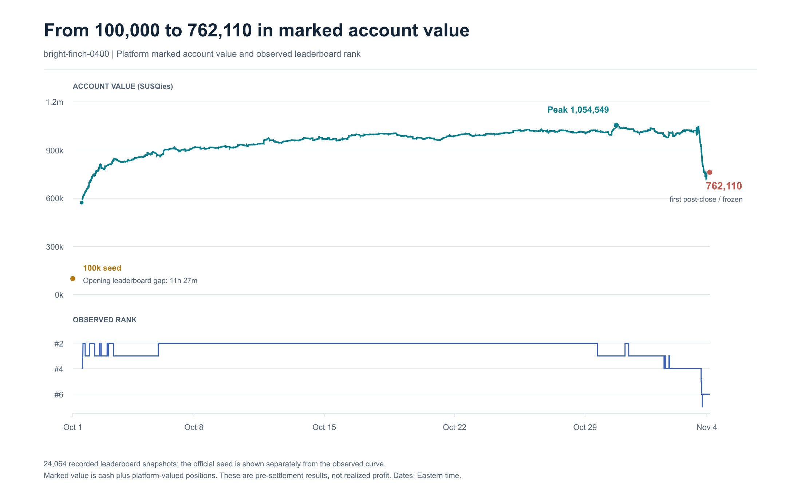
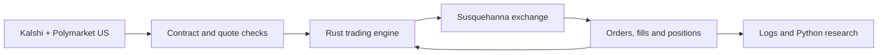
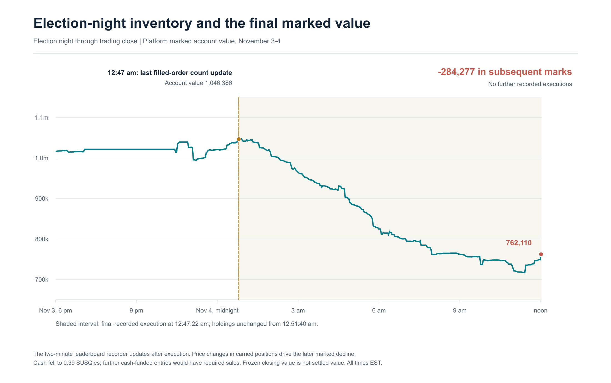
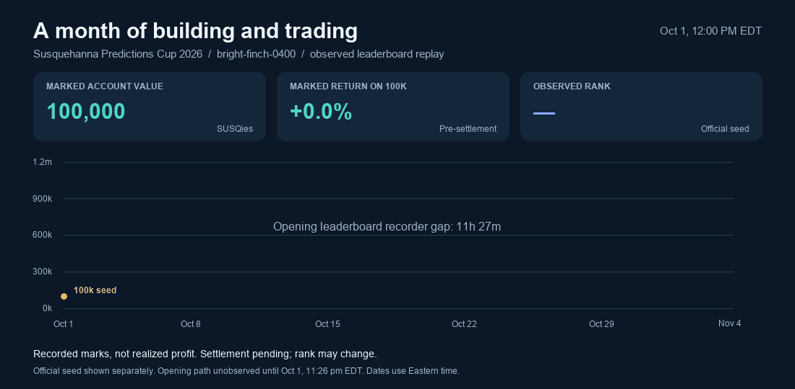

# Building a trading bot for the Susquehanna Predictions Cup

[Interactive report](https://tristandarnell.github.io/Susquehanna-Predictions-Cup-Writeup/) · [Technical notes](docs/technical-retrospective.md) · [Data and methods](docs/methods.md)

<picture>
  <source media="(prefers-color-scheme: dark)" srcset="figures/01-equity-and-rank-dark.png">
  
</picture>

I ran a Rust trading bot in the Susquehanna Predictions Cup from October 1 to November 4, 2026. The account started with **100,000 SUSQies** and ended trading in **sixth place**, with **762,110 in marked account value (+662.1%)**. It peaked at 1.055 million and reached second place during the month.

These are virtual competition funds. Positions are still awaiting settlement, so the final value and ranking can change.

## The core strategy: stink bids

The main strategy was **stink bidding**: leave buy orders well below the reference price and sell orders well above it. Large aggressive orders sometimes swept through several price levels and filled ours. The bot then tried to close the position when the price bounced back, freeing cash for the next sweep.

Early layers sat **6–20 cents from fair value**, estimated from matching contracts on **Kalshi and Polymarket US**, with additional walls at 5 and 95 cents. Orders could step one tick ahead of a large competing wall. Later versions used **3/4/5-cent ladders around Susquehanna’s own price** to catch smaller moves that might reverse quickly.

The hard part was getting out. A good entry against an outside price did not guarantee a bounce on Susquehanna. Some sweep fills tied up cash for days. Separately, I kept selected positions for settlement, including a large Rhode Island holding.

The engine used **Rust and Tokio**, with WebSocket updates and REST reads to recover missed fills and check account state. Python handled research and monitoring. Manual trades also changed the account, which became important later.

Small data errors could produce convincing trade signals. One mapping linked a governor contract to a lieutenant-governor market. A thin outside order book could also make its midpoint misleading. The bot needed checks on the contract, quote age, spread, and disagreement between sources before using a price.

## Getting orders and cash right

The account was already marked at about **806,000 by the end of October 2**. Keeping it trading was harder than the early growth suggested.

Some fills arrived late through REST. Others appeared in both order responses and WebSocket messages. Counting one twice could make the bot send the wrong exit. An order request could also time out while the order remained live at the exchange.

The fixes included duplicate handling, retries that reused the same request key, and reservations for pending orders. Cancels received priority over new orders.

Cash was another constraint. In Rhode Island Senate, the bot traded an extra NO position around a protected core holding. It sold YES into price spikes, then tried to buy it back after the price fell. Even a buyback that reduced exposure still needed available cash under the venue's rules.

<picture>
  <source media="(prefers-color-scheme: dark)" srcset="figures/03-cash-and-basis-dark.png">
  
</picture>

Before election night, the regular sweep orders were tapered and cash recovered to roughly **500,000**. Almost all of it was then spent on new positions.

## A market-making idea that failed testing

Tighter quotes looked profitable in an initial replay: about **+1,250 per day** with an assumed place at the front of the queue. With a more realistic queue model, that became **−414 per day**. A later shadow run lost about **213 over 39 hours**.

Those were simulated results. The dedicated experiment stayed in shadow mode. Other traders' orders could absorb the ordinary flow ahead of ours, leaving us with fills from trades that kept moving through the level. Replacing orders too often also lost queue priority.

## Election night

The account entered the evening near **1.016 million**, in fourth place. Two things went wrong.

In MN-01, a manual purchase changed a small short into a large long, but an old exit setting remained at **0.01**. The bot then sold **50,000** newly purchased YES contracts under that stale rule, losing **25,939.53 against their purchase cost**, before any unshown charges. The exit setting should have reset when the position changed direction.

The larger decline came after trading stopped. At the final filled-order-count update, just after **00:47 EST**, account value was **1,046,386.23**. It then fell by **284,276.56** through the first post-close snapshot, without further recorded trades.

<picture>
  <source media="(prefers-color-scheme: dark)" srcset="figures/02-election-night-dark.png">
  
</picture>

Cash was down to **0.39**. Some apparently separate positions were also the same bet: Democratic YES and Republican NO both depended on a Democratic win.

## Code and data

Claude and Codex helped with coding, research, and debugging. I chose allocations, approved deployments, changed limits, and placed manual trades.

The account recorded **27.04 million in volume across 18,027 orders with fills**. The charts use **24,064 leaderboard snapshots**. The [technical notes](docs/technical-retrospective.md) cover the system and incidents in more detail; the [methods](docs/methods.md) explain the calculations and gaps in the records.

Watch the account replay

The recorder missed the first 11.45 hours, so the initial 100,000 is shown separately.

