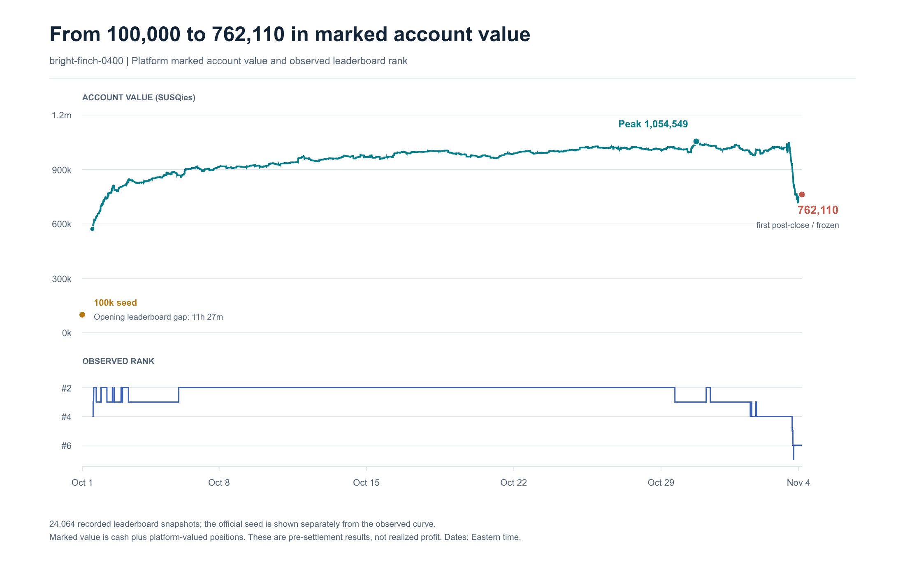
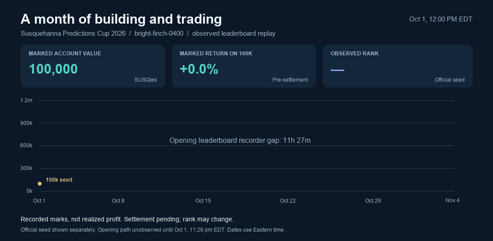
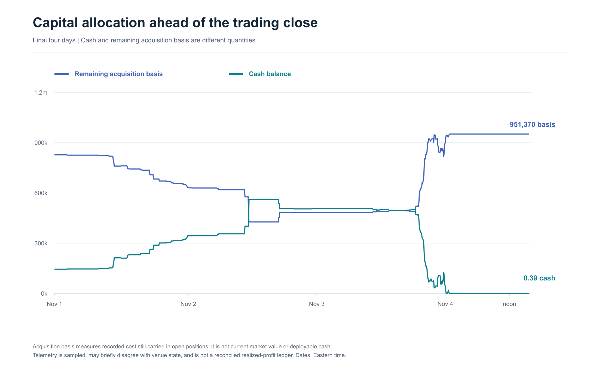
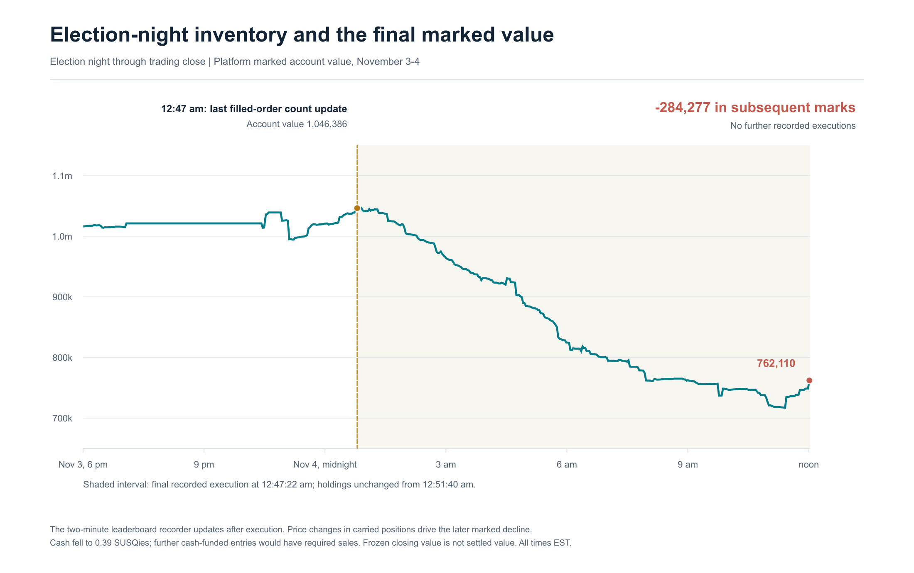
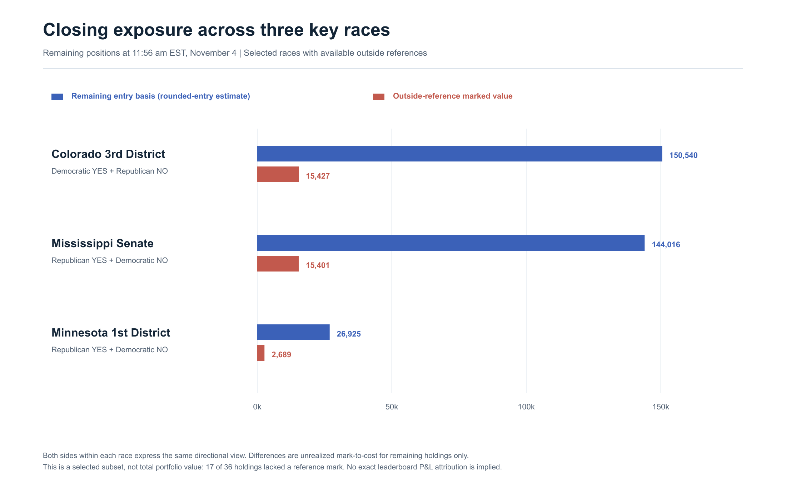

# SIG Predictions Cup: technical notes

[Overview](../README.md) · [Interactive report](https://tristandarnell.github.io/SIG-Predictions-Cup-Writeup/) · [Methods](methods.md)

I ran a Rust trading bot in the SIG Predictions Cup from October 1 to November 4, 2026. The account started with 100,000 SUSQies and reached **762,109.67 in marked value**, a **+662.11% marked return**, on the first post-close leaderboard. It stood sixth. The highest recorded value was 1,054,548.74, and the best observed rank was second.

These are pre-settlement results. Marked value includes open positions, so it is not realized cash profit. The account still held 36 positions when trading closed. Final standings follow [settlement](https://sig.thesuper.market/docs/settlement-and-payouts).



The venue reported 27,044,840.85 of volume and 18,027 orders with at least one fill. The largest observed drawdown was 32.00%. The recorder missed the opening 11.45 hours, so the chart shows the initial allocation separately from the observed curve.

<details>
<summary>Watch the account replay</summary>



</details>

## Stink bids and sweep ladders

The main strategy was **stink bidding**: leave buy orders well below the reference price and sell orders well above it, waiting for aggressive trades to sweep through the book. By October 3, the walls sat 6/10/12/14/20¢ from fair value estimated from matching Kalshi and Polymarket US contracts, with additional walls at 5¢ and 95¢. Within each zone, orders could sit one tick ahead of a large competing wall.

Later ladders used SIG's own price to target temporary local moves. By October 7, their offsets were 3/4/5¢. The exit engine recorded the price before a sweep and used staged exits to recycle inventory, freeing cash for the next wave. Selected directional positions were held for settlement; those holdings were separate from the sweep lots intended to trade back out.

A registry mapped contracts and inverted outcomes where necessary. This was easy to get wrong. Some governor contracts had been linked to lieutenant-governor references; those mappings had to be removed. Similar names did not establish that two contracts would settle the same way.

The reference calculation rejected stale, invalid, and excessively wide quotes, checked disagreement between sources, and retained a conservative bid/ask band. An outside midpoint was still only a reference. It did not establish that the same quantity could be hedged elsewhere.

A contemporaneous October 5 review corrected an early diagnosis of the California governor incident: the reference was right and the sweep was real. It simply did not reverse. Together with a Delaware Senate sweep, the expensive NO collateral tied up about 211,000 of cash. Resting orders stayed oversized as cash fell, and the engine's kill switch failed to cancel the base sweep orders.


The engine used Rust and Tokio, with WebSocket updates and REST reads for recovery and reconciliation. Python handled research, monitoring, and operator tools. The first recorded live start was October 1 at 11:38 EDT with 237 mapped markets. Manual trades and separate helpers also changed the account, so the engine had to reconcile more than its own orders.

## Inventory and cash

The account was marked at roughly 805,650 by the last observation on October 2 and 907,417 by October 6. Some increases came from trading; others came from changes in the value of positions already held. The account curve alone cannot separate them.

Rhode Island Senate became a large holding. The bot held Republican NO contracts and traded an extra slice around a protected core. Selling YES into a price spike increased the NO position; buying YES back after a reversal closed the added slice. The core was 630,792 NO contracts when the slice was enabled on October 8 at 20:05 EDT.

The buyback still needed cash under the venue's rules. On October 15, cash fell very low while there was inventory left to buy back. Describing an order as a reduction did not mean the exchange would fund it automatically. A fill could look profitable at the reference price and still leave the account unable to take the next trade.



The ordinary sweep ladders were tapered on October 30 in the evening. Before election-night trading, cash had recovered to roughly 500,000. That reserve was subsequently committed almost entirely to inventory. Raising cash had worked; the later allocation of that cash was the problem.

## Testing tighter market making

Tighter quotes seemed worth testing because they might turn inventory over faster. The queue assumption changed the answer.

An October 12 replay made about **1,250 per day** when it assumed the bot was first in the queue. With the more realistic queue model, it lost about **414 per day**. A later forward shadow run lost about **213 over 39 hours**. These were simulation and shadow results; the dedicated reference-market-making experiment stayed out of live trading.

Orders already ahead of the bot could absorb ordinary flow. The trades that reached its quotes could be the ones that kept moving through the level. Replacing an order too often also lost queue priority. A backtest needed to account for those effects, as well as partial fills, finite opposing volume, available cash, and cancellation delays.

The same constraints applied to wider ladders. We tested depth, refill timing, inventory limits, and reservations, but several variants stayed disabled. More turnover was not enough: the account second on the closing leaderboard reported about 2.70 million of volume, compared with our 27.04 million. That did not reveal its strategy, but it made trading volume a poor target on its own.

## Keeping the account state correct

Execution problems included orders acknowledged without usable IDs, delayed REST fills, duplicate information across API responses and WebSocket messages, and stale position snapshots. Separate processes also competed for the same account limits.

These errors changed trading decisions. A late fill could leave the bot planning an exit from the wrong quantity. A duplicate notification could make it reduce a position twice. An order with an unknown submission outcome might still exist at the exchange, making an immediate retry dangerous.

We added pending-order reservations, idempotent submissions, cancellation priority, and reconciliation against account reads. Expiries were staggered to avoid replacing too many orders at once. Manual website trades remained a complication: they could change a position without clearing instructions that the bot had attached to its earlier state.

## Preparing for election night

The election-night paths used external price moves, confirmation periods, time windows, and separate cash and position limits. The later Kalshi helper used an initial qualifying observation followed by persistence at the same venue. Those stages were not independent sources, and a market-price “call” was not necessarily an official race declaration.

The C8 House price-jump path was included in the November 3 evening deployment. The captured journal contains thousands of skip events but no recorded C8 jump dispatches. It therefore gets no performance credit here. It had its own sizing rules, so the normal order-size cap alone does not explain why it did not dispatch.

At 17:58 EST on November 3, the account was marked at 1,015,904.89 and ranked fourth. At 23:59, it was 1,020,780.77, still fourth. The final night then exposed both an execution bug and the risk in the remaining portfolio.

## The MN-01 exit bug

At about 23:04 EST, a manual purchase bought 77,519 MN-01 Republican YES contracts at 0.645. That reversed a small short into a large long. An old exit pin at 0.01 remained active.

The bot used that pin as the sell floor for the new long and sent two 25,000-contract exits. Their order responses record proceeds of 4,731.17 and 1,579.305. The 50,000 contracts sold had cost 32,250 at the purchase price:

```
Gross proceeds:        6,310.475
Matched purchase cost: 32,250
Gross loss:           25,939.525
```

That is a **25,939.53 gross loss against purchase cost**, before any unshown charges. The position quantities also reconcile: −519 + 77,519 − 50,000 = 27,000. Using the order totals avoids double-counting overlapping fill notifications.

The old exit rule should have been invalidated when the position changed direction. A price alone was not enough to describe the instruction; it also needed to identify the position and direction it belonged to.

## The decline after the final trade

The last recorded execution occurred at **00:47:22 EST on November 4**. The final filled-order-count update appeared at 00:47:49, with the account marked at **1,046,386.23**, still fourth.

Volume and filled-order count then stayed fixed. Position snapshots showed unchanged quantities and entry averages from 00:51 onward. By the first post-close snapshot, marked account value had fallen to 762,109.67, a decline of **284,276.56**.



This later decline came from repricing holdings. Fixing the MN-01 exit bug would not have removed that portfolio risk. Cash had fallen to 0.39, so further cash-funded entries required selling something or receiving a payout first.

Some holdings were separate contracts expressing the same bet. Democratic YES and Republican NO both benefited from a Democratic win. They needed a shared exposure limit.

The final pre-close snapshot showed the following remaining holdings. Acquisition basis uses recorded entry averages; reference value uses available prices from the same snapshot.

| Race exposure | Approximate basis | Reference value | Unrealized difference |
|---|---:|---:|---:|
| CO-03 Democratic YES + Republican NO | 150,539.75 | 15,427.04 | −135,112.71 |
| Mississippi Senate Republican YES + Democratic NO | 144,016.29 | 15,400.81 | −128,615.48 |
| MN-01 Republican YES + Democratic NO | 26,924.65 | 2,689.32 | −24,235.32 |



These figures exclude exited lots and earlier profits. They show the remaining exposure, not total race P&L or an exact breakdown of the differently marked leaderboard decline. CO-03 and Mississippi alone had about 294,556 of acquisition basis against 30,828 of reference value.

## Closing valuation

The bot reported about 265,930 in `value_at_fair` just before close, but the calculation omitted **17 of 36 holdings** because their references were missing. Those positions included Rhode Island and represented about 444,517 of remaining basis. After close, all references disappeared and the field became zero. Neither figure was a complete portfolio value.

Claude and Codex helped with code, research, debugging, and analysis. I set allocations and limits, approved deployments, and placed manual trades.

The calculations use 24,064 leaderboard snapshots and extracts from a 10.9-million-row journal. The [methods appendix](methods.md) covers fill duplication, price coverage, source provenance, and the remaining gaps in realized and per-strategy P&L. [Metrics](../data/metrics.json) and [daily observations](../data/daily-observations.csv) are included with the charts.
